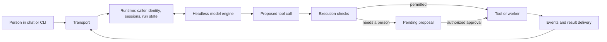

# Engineering an agent harness

**Human approvals, persistent conversations, and measured performance around a headless coding agent.**

I extended an existing agent runtime to support agents working in team chat: answering
questions over documents, proposing changes to shared records, and running longer tasks.
My work focused on the parts between a model response and a dependable service: identity,
approval gates, questions that reach a person, recovery, observability, and evaluation.

This repository contains an engineering case study and a small runnable demonstration of
context injection, tool-call guards, and audit logging. The full runtime and its private
integrations are not included. Examples use fictional data; evaluation exports contain
timing, cost, and scoring metadata only. Organization names, client information, source
documents, prompts, and answers are omitted.

## What I built

The original runtime was built by a colleague. These are the areas I extended and tested:

| Area | Work |
|---|---|
| Execution and identity | A common entry point carrying the caller's identity; checks at the operation that executes a change; protection against agents approving their own work. |
| Human interaction | A bridge that pauses a headless turn, posts a question to its conversation, and returns the person's answer to the running engine. |
| Reliability | Progress and status messages, recovery around usage limits and restarts, detached workers, and steering a running turn with a new message. |
| Observability | Ordered conversation events, model and tool telemetry, and per-call cost accounting. |
| Performance | Per-turn reasoning effort, bounded conversation context, reduced repeated memory injection, and a separate answer mode for questions. |
| Evaluation and memory | Repeated task replays, blind grading, checks on the evaluation setup, and experiments comparing accumulated lessons with smaller or absent memory. |

Read the [harness case study](docs/harness.md) for the mechanisms, trade-offs, and work
that remains open.

## Measured result

On a private set of **45 tasks, repeated three times per configuration**, answer mode
and whole-record reading improved the harness from **41 to 43 tasks solved**. Plain
Claude with the same underlying model solved **44**.

| Configuration | Tasks solved / 45 | Median 10-turn conversation | Estimated cost / successful task run |
|---|---:|---:|---:|
| Existing harness | 41 | 587 s | $1.04 |
| + answer mode | 41 | 542 s | $0.99 |
| + answer mode and whole-record reading | 43 | 483 s | $0.91 |
| Plain Claude | 44 | 813 s | $1.05 |

The improved configuration had about **41% lower conversation latency** and
**13% lower estimated cost per successful task run** than plain Claude. It still missed one more
task. These are descriptive results on this task set, with model-assisted grading;
they do not establish accuracy parity or general performance on other workloads.
Cost is the engine's API-rate estimate, rather than invoiced subscription spend.

The [evaluation method and limitations](docs/evaluation.md) explain the scoring and
the remaining gap. The [sanitized run metadata](evaluation/runs.jsonl) and
[summary script](evaluation/summarize.py) reproduce this table without releasing the
underlying business material.

## How the system is organized



The model chooses what to propose. The runtime checks whether the caller may execute
it and whether a person must approve it. Context helps the model choose well; it does
not replace those checks. The [architecture notes](docs/architecture.md) describe the
boundaries and the distinction between evidence, reviewed records, and memory.

## Run the public demo

Requires Python 3 and Bash. The first command makes no model calls:

```bash
git clone https://github.com/0xtigerclaw/ai-native-investment-house.git
cd ai-native-investment-house
./verify.sh --no-model
```

This runs ten assertions against the guard, including permitted writes and read-only
commands. To run the additional model-in-the-loop probes, install and authenticate
Claude Code, then run `./verify.sh`. The full suite uses `bypassPermissions`; inspect
the scripts and run it in a disposable checkout inside an OS sandbox. The demo's
shell-pattern checks are illustrative and do not provide a security sandbox.

To watch local hook events:

```bash
python3 viewer/server.py
# Open http://127.0.0.1:7877
```

| File | Purpose |
|---|---|
| [`.claude/settings.json`](.claude/settings.json) | Registers the hooks with the engine. |
| [`rails/inject_context.py`](rails/inject_context.py) | Looks up fixture facts and adds them to a turn's context. |
| [`rails/guard_vault.py`](rails/guard_vault.py) | Allows or denies selected file and shell operations. |
| [`rails/trace.py`](rails/trace.py) | Records tool events in a hash-linked local log. |
| [`vault/`](vault/) and [`data/facts.json`](data/facts.json) | Fictional fixtures for the demonstration. |
| [`viewer/`](viewer/) | A local, read-only view of debug events. |

The demo implements the three hooks. Approval execution, transport, session management,
effort routing, retrieval services, and the memory pipeline are described in the case
study but are not shipped here. See the [walkthrough](docs/demo-walkthrough.md) and
[engineering findings](docs/findings.md) for what the probes establish and their limits.
