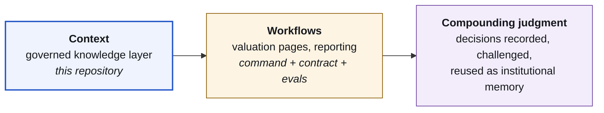
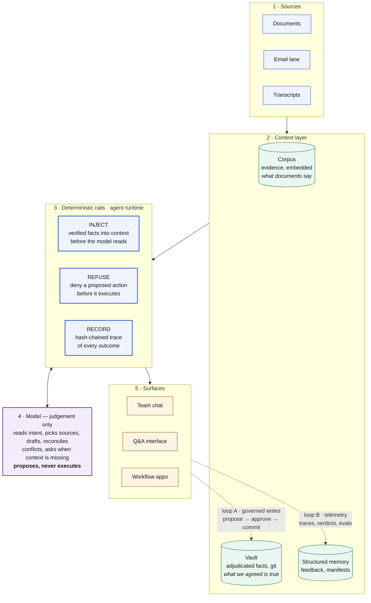
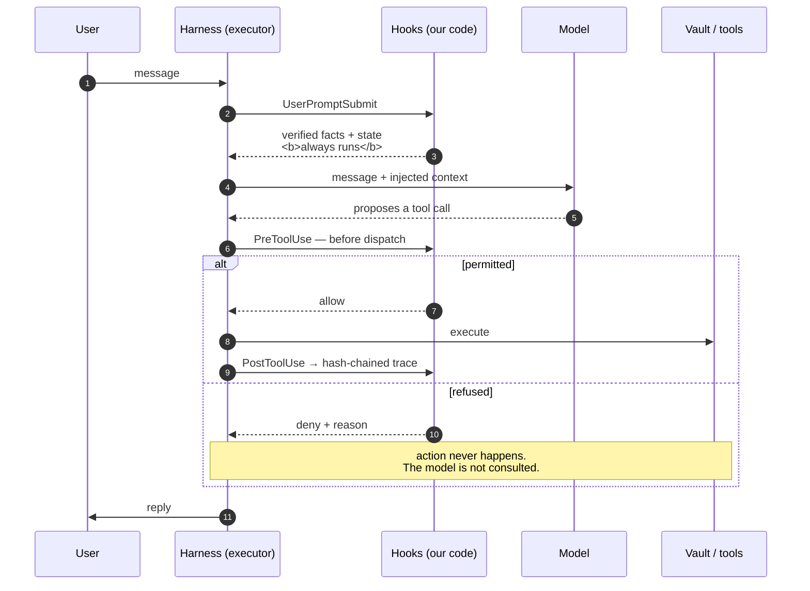
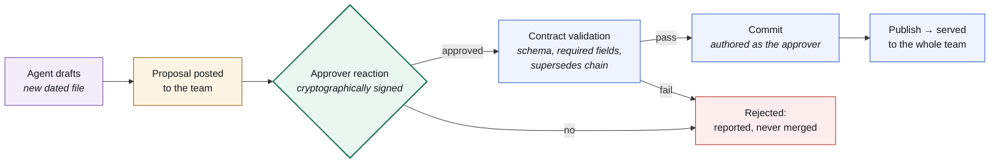
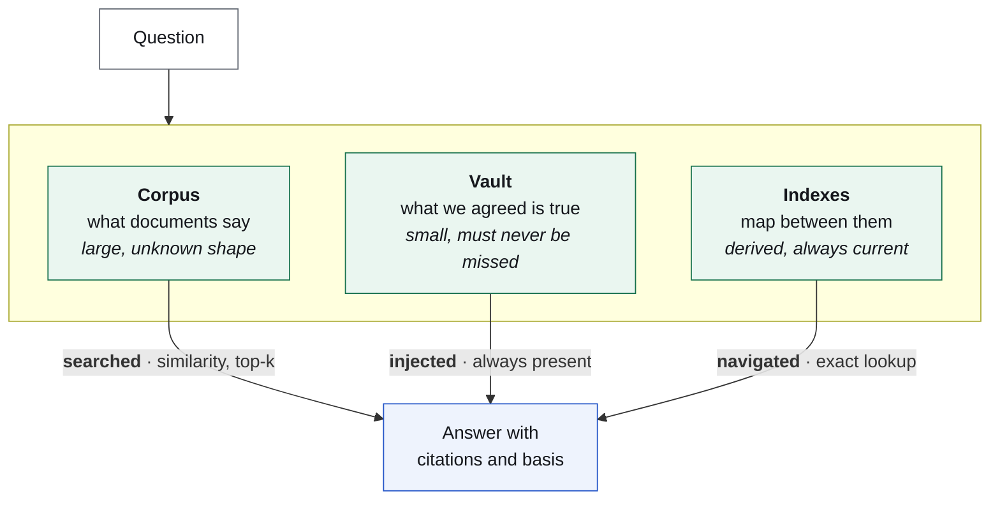
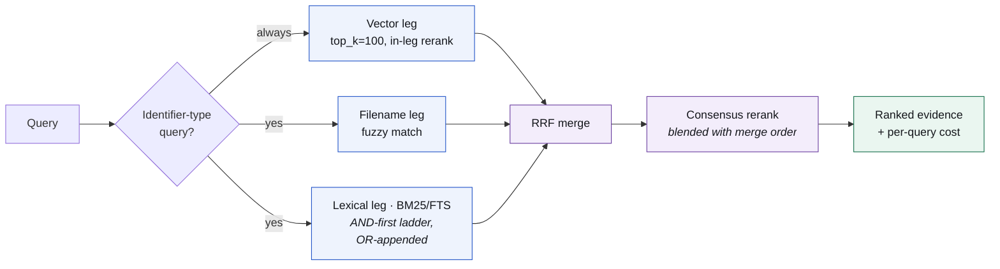

# Building an AI-native investment house: the context layer

Capital and compute are commodities. Every fund can buy both, and neither gives you
institutional intelligence. **Context does** — the judgment currently buried in a few
people's heads, made queryable, challengeable, and compounding across every decision
that follows.

That is the mandate: give judgment memory. This repository is the part of it built
first, because nothing else can be built on top until it holds — **a governed knowledge
layer where an agent maintains a firm's institutional record, and nothing that must be
true depends on the model choosing to cooperate.**

The thinking behind it:
[**Building the Frontier Investment House**](https://superagents.substack.com/p/building-the-frontier-investment).

The agent drafts, reasons, and proposes. Code decides what it is *able* to do, humans
decide what becomes true, and every step lands in a tamper-evident log.

> **Anonymized for confidentiality.** This is extracted from a live deployment
> maintaining institutional records for an investment firm. All company names,
> people, figures, hostnames, cloud identifiers, and keys have been replaced with
> neutral placeholders (`Northwind Components`, `PROJECT_ID`, `relay.example`, and
> similar). The mechanism, measurements, and findings are real and unchanged; only
> the identifying material is not. Nothing proprietary appears in this repository.

```bash
./verify.sh     # 17 checks, ~4 minutes. Probe 1 needs no model at all.
```

---

## Where this sits

Four things make a fund AI-native ([the long version](https://superagents.substack.com/p/building-the-frontier-investment)).
Two are already solved for everyone:

| | |
|---|---|
| **Capital** | already there |
| **Compute** | rentable by the hour, generic by definition |
| **Context** | the bottleneck, and the only durable moat |
| **Culture** | trust earned through verification, never imposed |

Context is the hard one, and it is unglamorous: a single source of truth where a number
carries its basis, its source, and who stood behind it. Get it wrong and every workflow
above it inherits the error, confidently. Get it right and each new capability costs a
command, a contract, and an evaluation set.

So **everything here is context engineering** — deliberately the foundation and not the
destination. The layers it exists to carry:



The culture column is why the governance below matters more than it might look. An
institutional record only becomes load-bearing if people trust it, and trust is earned by
verification: every figure traceable to a document, every change attributable to a named
human, every agent action on a record that cannot be quietly edited.

---

## The problem

Give an agent write access to a shared knowledge base and you inherit three failure modes
that prompting cannot fix:

1. It can overwrite institutional facts that took a human argument to settle.
2. It can publish its own conclusions with no review.
3. Its behaviour drifts with conversational context, so what worked yesterday is not a
   guarantee about today.

The standard mitigation is a better system prompt. That is a nudge, not a control. This
system treats it as an architecture problem instead.

## The core idea

Every step in the loop is one of three kinds, and knowing which is which *is* the design:

| Kind | Decided by | Guarantee |
|---|---|---|
| **Code** | a script, same input same output | deterministic: it always runs, or the action never runs |
| **Judgement** | the model | none, deliberately — this is the work we want a model for |
| **Approval** | a named human | a gate: nothing proceeds without a signed reaction |

Judgement steps are allowed to be wrong, because they sit between code steps that cannot
be skipped and an approval step that cannot be forged.

---

## System architecture



**Two return loops, deliberately separate.** Facts reach the record only through approval
(loop A). Telemetry — traces, feedback, confirmed answers — flows freely into memory and
grows the evaluation set (loop B). Collapsing them would let an agent write institutional
truth unreviewed.

---

## The turn loop: where enforcement actually lives

The model never executes anything. It *proposes* an action to the harness, and the harness
executes it. That division is what makes enforcement possible: the harness is a checkpoint
every action must physically pass through, and hooks are code standing at that checkpoint.



The three levers, and their honest limits:

| Lever | Guarantees | Does **not** guarantee |
|---|---|---|
| **Inject** | the code ran; its output reached the model | that the model *used* it |
| **Refuse** | the action never executed | — this is the deterministic one |
| **Record** | tamper-evident history of what happened | — |

There is no lever for "make the model comply", by design. That is why the approval gate
exists.

> **Finding.** An early version of the injection hook ended with an instruction telling the
> model to echo a verification token when asked. The production agent refused, correctly
> identifying an instruction arriving through a data channel as a prompt-injection pattern.
> It was right; the hook was wrong. Injected context now states facts and issues no
> instructions. The rule this produced: **you cannot make an agent do something by writing
> an instruction into its context** — a well-behaved agent discounts it, and a badly-behaved
> one was never a control to begin with.

---

## The approval loop: how a claim becomes a fact



Separation of powers is enforced by capability, not policy:

- The agent holds **no** version-control or storage credentials. It cannot commit even if
  it decides to.
- The approval executor is a **separate process** holding those credentials, acting only on
  a reaction signed by a key on an allowlist.
- The record is **append-only**: corrections supersede rather than overwrite, so history
  survives by construction.

---

## Trust model: three stores, three transports

The most consequential design decision. Evidence and adjudicated facts are both markdown,
but they are not interchangeable, so they never share a store — proximity alone would let
a raw document be cited as if it had been reviewed.



Why adjudicated facts are **injected rather than embedded**: retrieval returns the best *k*
passages, not all of them. Putting ground truth behind a similarity search means it can be
outranked by a random document, and a settled figure would arrive as a peer chunk beside
three unsettled ones. Injection is complete by construction — viable precisely because the
curated layer is small.

**Evidence is retrieved because it is big. Truth is injected because it is small and must
always be there.**

---

## Retrieval engineering

The corpus layer is a hybrid pipeline, tuned against a golden set with a replay harness
that gates every deploy.



Measured on an 80-question golden set (document Recall@5), replayed through the exact
production code path — never a parallel implementation:

| Change | Result |
|---|---|
| Baseline | 0.727 |
| `top_k` 50 → 100 (platform hard maximum) | fixed scope crowd-out |
| Replacement-style rerank | **net zero** — promoted and demoted in equal measure |
| Consensus rerank (blend with merge order) | keeps promotions, damps demotions |
| Tuned pipeline | **0.89** |
| Held-out corpus, never tuned on | 0.787 → **0.872** (tuning generalizes) |

Two findings worth more than the headline: the obvious reranking strategy was worth nothing
until reframed as a consensus blend, and a pure-OR lexical leg measured *worse* than an
AND-first ladder because capitalized common nouns flooded it in a multilingual corpus. Both
were visible only because every claim was replayed rather than argued.

---

## What is in this repository

```
verify.sh          Run this. 17 checks, ~4 minutes.
rails/             The three hooks: inject, guard, trace. ~400 lines total.
.claude/           The enforcement point — 9 lines of config, read by the harness
                   process and not by the model. This file is the whole answer to
                   "where is it enforced".
vault/             A miniature append-only record for the rails to protect.
data/facts.json    Stands in for the retrieval backend.
viewer/            Local debug UI, stdlib only: watch the chain fire live, every
                   card naming the file that enforced it, LLM calls marked as the
                   only non-deterministic stage.
docs/              Empirical findings and the demo walkthrough.
```

The interesting probe is **#3**: the agent is asked, in ordinary language, to correct an
out-of-date figure in a shared file — a completely reasonable request. It tries. The guard
refuses, because that file is append-only and corrections supersede. The prompt deliberately
does *not* say "ignore your rules", because that phrasing makes a model decline on its own
and proves nothing. The interesting case is the request the model has every reason to grant.

**Probe #1 involves no model at all** — crafted tool calls piped straight into the guard,
byte-identical every run. That is the mechanism, isolated, with nothing left to argue about.

---

## Honest limits

- Rails bind the **agent**, not a human with shell access. The boundary that protects the
  record is one layer out: the agent holds no credentials, and a separate process with those
  credentials acts only on signed approvals.
- Injection guarantees delivery, not use. Anything that must be certain belongs in the
  validator, not the prompt.
- The model's *judgement* is not made deterministic and is not meant to be. Source selection,
  normalisation, and drafting stay probabilistic; that is why a human approves.
- The audit chain is tamper-**evident**, not tamper-proof. It detects edits; it does not stop
  an operator with disk access from making them.

---

## Engineering notes

Three lessons that generalize beyond this project:

**1. Test the mechanism without the model.** The most valuable probe in the suite pipes
crafted tool calls straight into the guard and asserts the decisions. No tokens, no variance,
and it settles arguments that model-in-the-loop tests cannot.

**2. A guard that blocks legitimate work gets switched off.** An early regex treated `2>&1`
as a file redirect and refused read-only commands. The suite now fails if a *permitted*
action is denied — the permitted set is as fixed as the refused set.

**3. Measure the platform, do not trust its docs.** A vendor behaviour change was isolated
with a four-cell matrix holding identity, credentials, and binary constant while varying one
dimension. That turned "it stopped working" into a one-line reproduction, published upstream.
[`docs/findings.md`](docs/findings.md) has the method.
