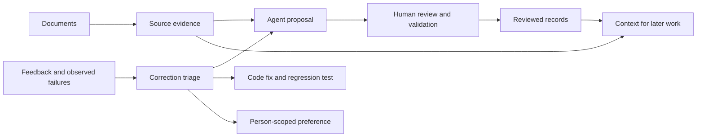

# Architecture and boundaries

This describes the larger runtime behind the case study. The public demo implements
only the three hooks in `rails/`; it does not include the transport, approval executor,
retrieval backend, or session service.

## Responsibilities

| Component | Responsibility |
|---|---|
| Transport | Deliver messages and attachments, show progress, preserve a delivery journal around restarts. |
| Conversation runtime | Map a conversation to a session, serialize or fold incoming messages, interpret stop and background commands. |
| Engine adapter | Run the headless engine, supply its context and tools, return questions and results. |
| Execution and approval path | Check caller identity and capability scope; hold actions that require an authorized person. |
| Workers | Run detached work with its originating person and conversation attached. |
| Event stream | Record conversation activity and telemetry for inspection, delivery, and replay. |
| Knowledge integrations | Read evidence, propose record changes, and validate approved updates. |

Boundary tests matter because each component can pass its own suite while disagreeing
with its neighbor. Examples included a watcher ending before a turn had claimed its
session, progress pagination failing after a bounded list rolled over, and callers
reading different versions of a thread record.

## Three kinds of information

**Source evidence** records what a document says. Retrieval helps find candidate sources;
the answer still needs the right passage, version, and interpretation.

**Reviewed records** hold accepted facts, their basis, sources, and review history.
Agents propose changes; a designated person approves publication. Corrections should
preserve what they supersede. An approval records acceptance, rather than making a
claim infallible.

**Memory** carries lessons, corrections, and preferences across turns. It must not turn
an unreviewed model conclusion into an accepted organizational fact. Its effect on
future answers also needs measurement.

The intended feedback paths are separate:

Correction-to-code automation remains incomplete. The diagram includes that intended
path to show where it belongs, not to claim it is already operating end to end.

## What the public hooks establish

| Hook | Demonstrated behavior | Limit |
|---|---|---|
| `UserPromptSubmit` | Code looks up fixture data and returns additional context. | Delivery does not ensure the model uses the information correctly. |
| `PreToolUse` | A deny result blocks a matched tool call when the host honors the hook. | Tool coverage, shell parsing, hook configuration, and host behavior bound the claim. |
| `PostToolUse` | The hook records executed tool events; the guard records denials. | This is a local demonstration, without concurrency controls or an external log anchor. |

The host executes tool calls proposed by the model. That gives the runtime a place to
enforce checks, but the checkpoint is useful only when all routes to a protected side
effect pass through it.

## Security limits of the demo

The guard uses an explicit set of tool names and shell patterns. It permits other
operations and is not a complete shell parser. An interpreter, alternative command
syntax, a newly added tool, or changes to the hooks themselves can escape its intended
coverage. A real deployment needs independently protected configuration, credentials,
execution isolation, and authorization checks at the underlying operation.

The context marker is deterministic from a public seed and a turn counter. It is useful
for correlating hook output with a reply; it is not an unforgeable proof.

The trace links each entry to the previous line's hash. Verification catches inconsistent
internal links. Without a separately retained trusted head, it cannot establish that
the tail was not truncated or that the entire log was not rewritten and rehashed. The
writer is also intended for serial demo use, not concurrent production logging.
